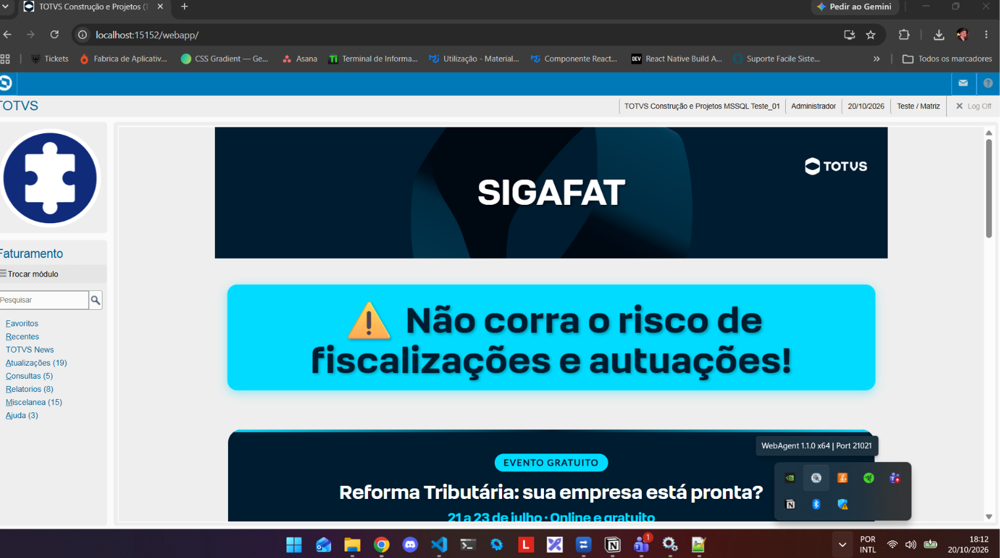
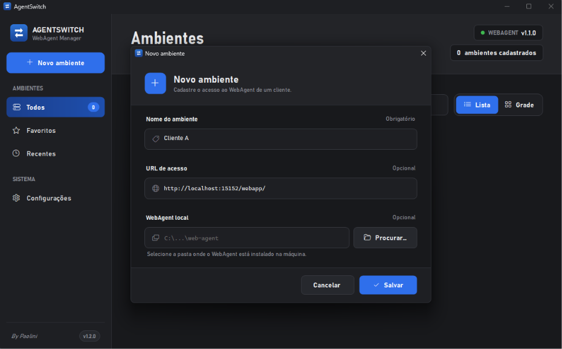
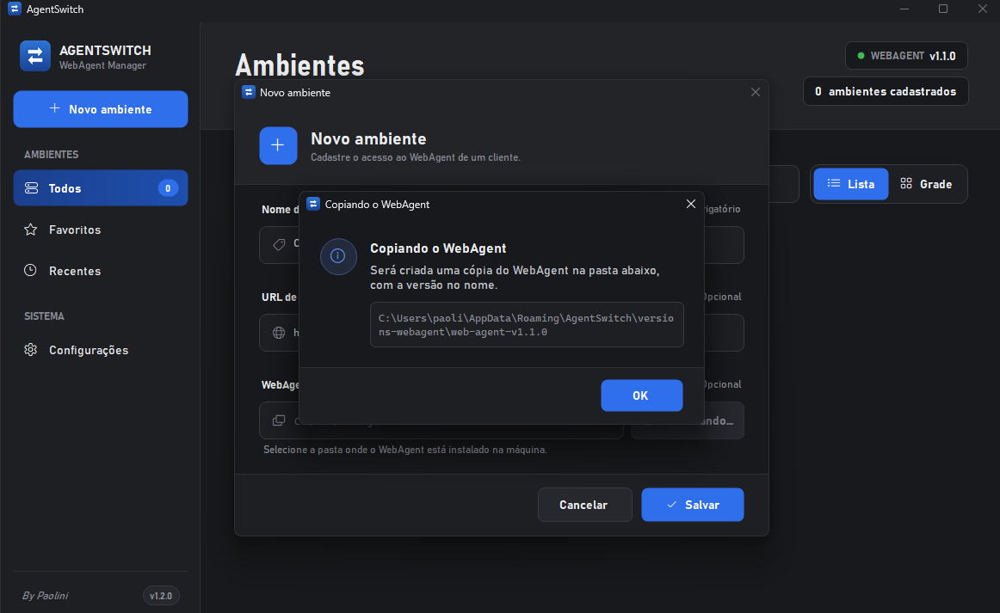
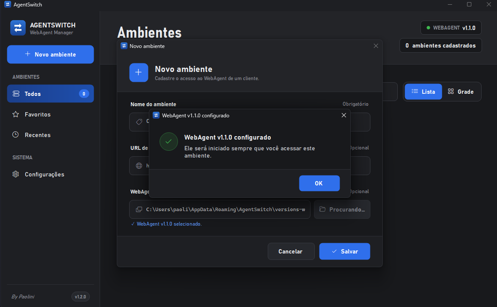
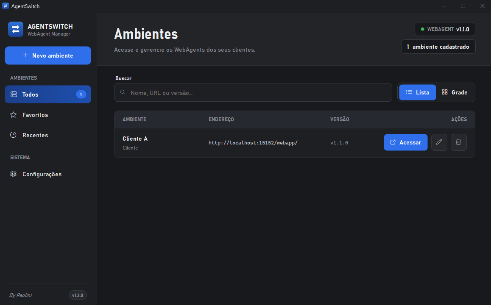
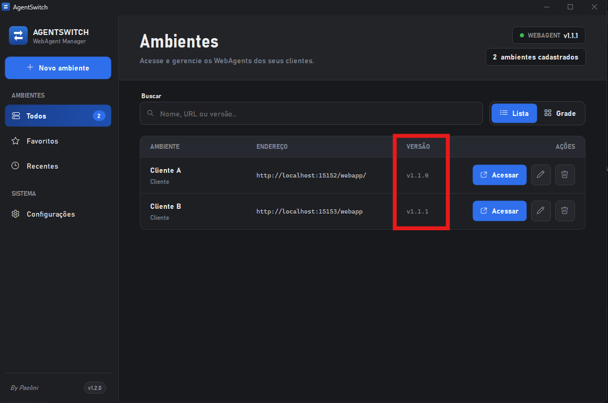

Se você atende clientes que usam o Protheus com versões diferentes do WebAgent, sabe como é chato ficar trocando de uma para outra. O AgentSwitch resolve isso: ele guarda cada versão do WebAgent separada e deixa você alternar entre elas sem conflito.

## Instalação

1. Baixe a [versão mais recente](https://github.com/paolini396/agent-switch-docs/releases/latest).
2. Extraia o arquivo `.rar` completo para uma pasta.
3. Execute o `AgentSwitch.exe`.

## Como funciona

Você cadastra os **ambientes** dos seus clientes uma única vez. Depois, para entrar em qualquer um deles, basta clicar em **Acessar**. O AgentSwitch então:

1. Encerra o WebAgent que estiver rodando.
2. Inicia o WebAgent do ambiente escolhido.
3. Abre a URL do ambiente no navegador padrão.

Assim você troca de ambiente sem precisar fechar um WebAgent e abrir outro manualmente.

## Como usar o AgentSwitch

### 1. Cadastrando um ambiente

**1.1** Acesse o Protheus normalmente, com o WebAgent instalado na sua máquina.

**1.2** Com o AgentSwitch aberto, clique em **Novo ambiente** para cadastrar o primeiro.

**1.2.1** Informe o nome do ambiente. Pode ser o nome que preferir; no meu caso, usei "Cliente A".

**1.2.2** Informe a URL de acesso ao ambiente. Esse campo é opcional, então pode deixar em branco se quiser.

**1.2.3** Por fim, informe a pasta onde o WebAgent está instalado. No meu caso, ele fica em `%LocalAppData%\Programs\web-agent`.

Assim que você escolhe a pasta, o AgentSwitch verifica se aquela versão do WebAgent já foi copiada antes. Se ainda não foi, ele cria uma cópia com a versão no nome (por exemplo, `versions-webagent\web-agent-v1.1.0`).

Depois da cópia, o campo do WebAgent passa a apontar para essa versão copiada e o ambiente fica configurado. É só clicar em **OK** e depois em **Salvar**.

Pronto, o ambiente está cadastrado e você já consegue acessar o cliente sem se preocupar com a versão do WebAgent.

Se tiver outros clientes, repita o processo para cadastrar cada ambiente.

### 2. Alternando entre ambientes

Com dois ou mais ambientes cadastrados, cada um com a sua versão do WebAgent, basta clicar em **Acessar** no ambiente desejado. O AgentSwitch abre a versão certa do WebAgent para cada um.

Segue abaixo um exemplo utilizando a ferramenta.

https://github.com/user-attachments/assets/3364378f-c9e0-4058-ae84-1c661fc72803

